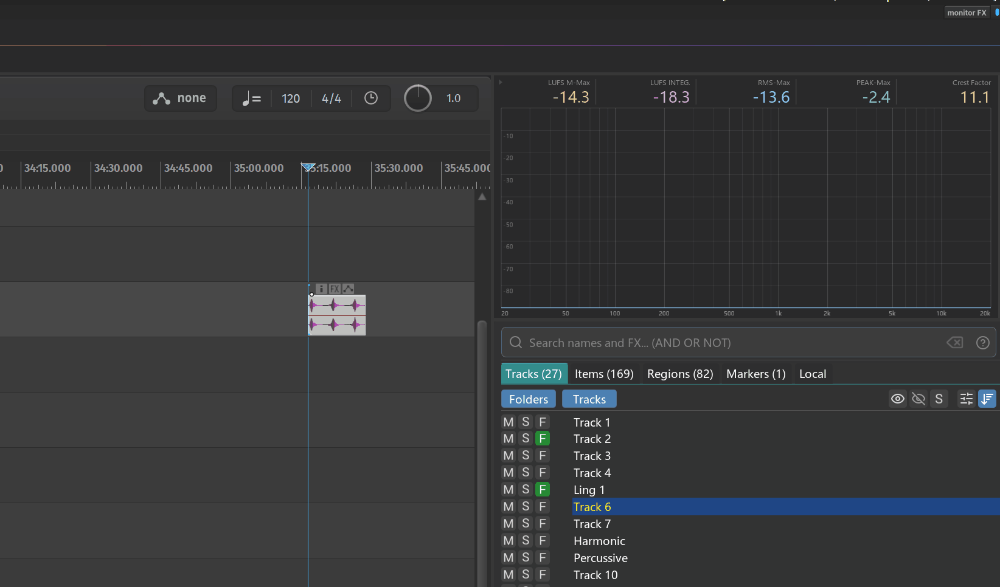
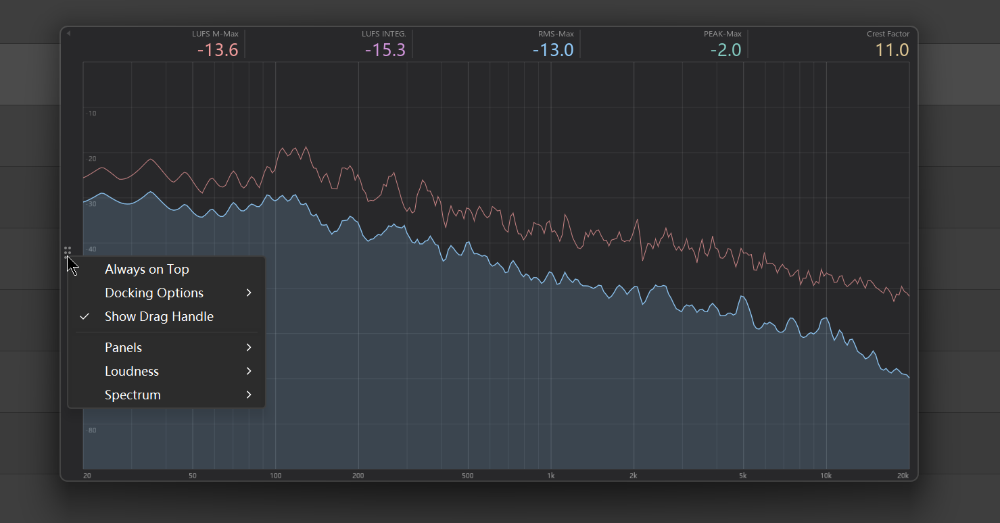
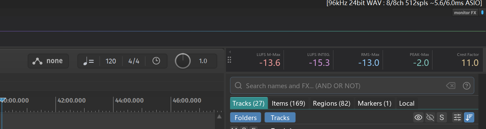
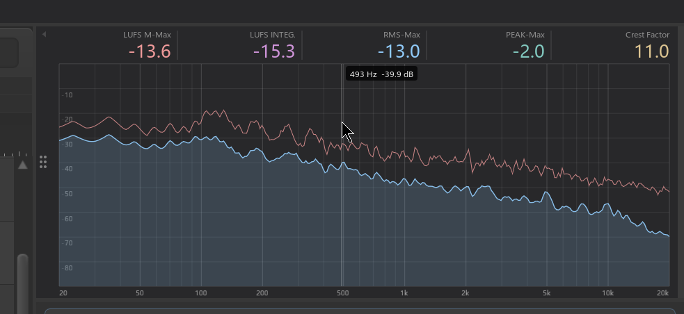
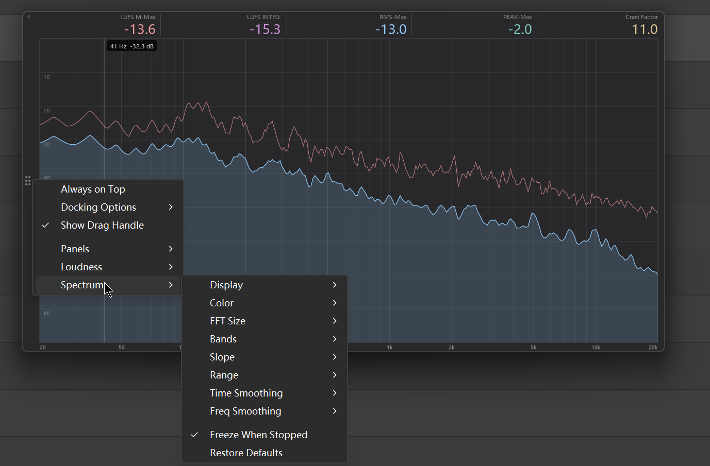

# Monitor Analyzer

---

## 1. Overview

**Monitor Analyzer** is a monitoring window that lives on the Monitor FX chain: a **loudness strip** on top, a **spectrum** below. It doesn't process audio — its job is to let you **glance at what you're hearing right now**.



Spectrum analyzers are nothing new. What makes this one worth using is that **it docks into REAPER** — it sits in a docker just like the Mixer or Media Explorer and becomes part of your workspace, instead of being yet another plug-in window floating around and getting buried. (See [Section 4](#_4-docking-into-reaper).)

A few other things worth knowing:

- **It analyzes what you actually hear**: sitting on the Monitor FX chain, it measures the monitor output (post-Master). It doesn't care which track or project you're in, and you never have to re-insert it when switching projects.
- **It shares the same Monitor FX CLAP plug-in with Sample Broker** — **once either one has been opened**, the other works immediately without a separate install.
- **Each panel can be turned on and off on its own**: keep only loudness for a thin strip, or give the whole window to the spectrum.

> This window used to be called **Loudness Meter** (loudness strip only). The action ID hasn't changed, so existing shortcuts and toolbar buttons keep working, and your window position, size and loudness settings carry over as-is.

---

## 2. Opening the tool

Menu path:

```
Extensions → Mantrika Tools → Monitor analyzer
```

Or search for "Monitor Analyzer" in the Action List:

| Action name | Function |
| --- | --- |
| **`mantrika : Monitor Analyzer - Loudness / Spectrum`** | Toggle the Monitor Analyzer window on/off |

The first time you open it, if the shared CLAP is not yet in place the whole window becomes a single **Setup** button — click it to mount the plug-in automatically.

---

## 3. Interface overview



```
 ▸ small triangle: left-click to collapse/expand the handle · right-click opens the settings menu
┌▾─┬───────────────────────────────────────────────────────────────────┐
│  │ LUFS M-Max  LUFS S-Max  LUFS INTEG.  RMS-Max  PEAK-Max  Crest Factor│  ← loudness panel
│::│   -18.3      -16.2       -23.4       -22.1     -1.2       12.1      │
│::├───────────────────────────────────────────────────────────────────┤
│::│                    ╱╲                                             │
│::│  ───────────╱╲───╱  ╲──╲___                                      │  ← spectrum panel
│::│            ╱  ╲╱         ╲____                                  │
│  │ 50   100    500   1k     5k    10k                              │
└──┴───────────────────────────────────────────────────────────────────┘
 ↑
drag handle: hold to move the window · right-click opens the settings menu
```

| Element | Interaction |
| --- | --- |
| **Drag handle** (vertical dots on the left) | Hold to **move the window**; **right-click** for the settings menu; **double-click** to restore the default size |
| **Small triangle** (top-left corner) | **Left-click** collapses / expands the drag handle; **right-click** also opens the settings menu |
| **Loudness panel** | **Right-click**: reset the loudness readings |
| **Spectrum panel** | **Hover** to read the frequency / level under the cursor; **right-click**: clear the spectrum (including the peak-hold line) |

### Collapsing the handle

Once the window is where you want it, you rarely need the handle anymore. Click the **small triangle** in the top-left corner to collapse it and both panels take up the full width — especially handy when docked.

- The triangle is always there (semi-transparent, lighting up on hover). **Pointing left** means a click will collapse the handle; **pointing right** means a click will bring it back.
- With the handle collapsed, **right-clicking the triangle** is the only way to open the settings menu.
- ⚠ **While floating**, collapsing the handle means the window **can't be dragged** (the handle is the only drag area of a floating window). To move it, click the triangle to bring the handle back.

---

## 4. Docking into REAPER

This is the **biggest difference** between Monitor Analyzer and a typical spectrum plug-in.

A plug-in analyzer means opening an FX window that floats over REAPER — either covering your tracks or getting covered by other windows, so you keep hunting for it. Monitor Analyzer is a native REAPER docker window, and it can sit alongside the Mixer, Media Explorer, Region Manager and friends:

- **Always in the same place**: dock it to the bottom, a side, or the top; it moves with the REAPER main window and never gets lost.
- **Share a docker with other windows** and switch between them as tabs — or place it side by side, e.g. next to Sample Broker. Both windows use the same background color, so together they look like a single panel.
- **Dock state is remembered**: whichever docker it was in, that's where it reopens.
- **Looks great as a thin strip, too**: show only the loudness panel, collapse the handle, and you get a readout bar along the bottom edge.



### How to dock

Right-click the handle (or the top-left triangle) → **Docking Options**:

| Menu item | Meaning |
| --- | --- |
| **Move to Docker → Bottom / Left / Top / Right** | Dock into REAPER's docker at that position (the current one is checked) |
| **Undock** | Turn it back into a floating window (only shown while docked) |
| **Close** | Close the window |

> On Windows, Docking Options is a submenu that expands on hover; on macOS you click it and a second menu pops up.

### What changes while docked

- The window's position and size are **controlled by the docker**. The handle is still drawn, but it only opens the settings menu — it no longer moves the window.
- **Always on Top is grayed out**: the window is already embedded in REAPER, so keeping it on top makes no sense.
- The handle can be collapsed whether docked or floating; collapsing it is recommended when docked.

---

## 5. Loudness panel

### What the six readings mean

| Column | Meaning |
| ------ | ------- |
| **LUFS M-Max** | Maximum momentary loudness (400 ms window) |
| **LUFS S-Max** | Maximum short-term loudness (3 s sliding window) |
| **LUFS INTEG.** | Integrated loudness (cumulative average per BS.1770) |
| **RMS-Max** | Maximum short-window RMS |
| **PEAK-Max** | Maximum sample peak |
| **Crest Factor** | `PEAK-Max − RMS-Max`, in dB (often abbreviated CF) |

- Values too low (≤ -70 dBFS) show `---`.
- **PEAK turns red immediately when it exceeds 0 dB**, warning of clipping.
- Each reading can be hidden individually from the right-click menu; the remaining modules **share the width automatically**, and a single remaining module fills the whole strip. At least one must stay visible — the last one can't be unchecked.

### About CF (Crest Factor)

**CF = PEAK-Max − RMS-Max** — in other words, how much the loudest transient in the current playback exceeds the loudest short-window RMS.

Intuitive guide (**larger number = spikier waveform, smaller number = flatter waveform**):

| Value | Typical material |
| ----- | ---------------- |
| **3 dB** | Pure sine / triangle wave (theoretical minimum) |
| **6–9 dB** | Brick-walled modern pop master |
| **10–14 dB** | General mix / vocals / guitars |
| **15–20 dB** | Real drums / percussion |
| **18–25+ dB** | Clean transient SFX (whoosh heads, impacts) |

> **Why not a "whole-clip average"?** Earlier versions of CF used the full-clip average RMS as the denominator. For SFX with long fade-out tails, the tail dragged the average down, so CF kept growing and never settled on a usable value. CF now locks to the loudest section: once the body has passed it stabilizes, and the number you see when playback stops is representative of the material.

When mastering or making final loudness judgments, read CF together with LUFS-I: LUFS-I tells you "how loud," CF tells you "how squashed."

### When the readings reset

Loudness readings accumulate **per playback pass**, not forever:

| Trigger | Behavior |
| ------- | -------- |
| **Stop → Play** | All readings reset and start accumulating from this pass |
| **Cursor jump during playback** (> 0.1 s) | Same as above: reset and start from the new position |
| **Playback stops** | Readings freeze at the last moment, so you can read the statistics for the whole pass |
| **Right-click the loudness panel** / menu **Loudness → Reset** | Manual reset (works while stopped too) |

This way **every press of Play is a clean measurement**, not polluted by the previous pass. To get the loudness of a section, just play through it once.

---

## 6. Spectrum panel



- **Live curve**: the current spectrum.
- **Peak-hold line**: the recent peak of each band; after a short hold it slowly falls back.
- **Hover readout**: move the mouse over the spectrum to see the **frequency / level** under the cursor. With Bands set to Musical it also shows the **note name** (e.g. `440 Hz  A4  -18.2 dB`) — handy for hunting resonances or checking pitch.
- **Right-click the spectrum**: clear the curve and peak-hold line and start fresh.
- By default the spectrum is **always live** and doesn't follow the transport. Only with **Freeze When Stopped** enabled does it clear and freeze based on play / stop (see below).

The defaults are sensible and **usually don't need changing**. Here is what each option does, in case you want to adjust.

### Spectrum submenu

| Menu item | Options | Description |
| --- | --- | --- |
| **Display** | **Curve** / Bars | Continuous curve, or segmented bars |
| **Color** | **Blue** / Green / Orange / Purple / White | Color scheme. Only changes the color — the peak-hold line is kept |
| **FFT Size** | 2048 / 4096 / **8192** / 16384 | Larger = finer low-frequency resolution but slower response. Use 16384 for low-end detail, 2048 / 4096 for transients |
| **Bands** | **Logarithmic** / Musical (note names) | Logarithmic frequency axis, or semitone-spaced bands with note names in the hover readout |
| **Slope** | **0 dB/oct (flat pink)** / +3 / +4.5 / +6 dB/oct | Tilt compensation. At the default 0, pink noise shows as a flat line; higher values make typical music "look flatter" — a matter of taste, not calibration |
| **Range** | -60 / **-90** / -120 dB | How low the bottom of the display goes. Use -120 to inspect noise floors and reverb tails |
| **Time Smoothing** | Off / Fast (120 ms) / **Medium (300 ms)** / Slow (700 ms) | How fast the curve falls. Slower = steadier, faster = more responsive |
| **Freq Smoothing** | Off / **1/24** / 1/12 / 1/6 / 1/3 oct | Smoothing along the frequency axis; wider = smoother. ⚠ Display only: pure-tone peaks get spread out and appear a few dB lower — **turn it off when you need an accurate level at a specific frequency** |
| **Freeze When Stopped** | On / Off (default Off) | Freeze the display when playback stops; see below |
| **Restore Defaults** | — | Reset all spectrum settings (including Freeze When Stopped) and clear the display |

(Bold = default.)

### Freeze When Stopped

By default the spectrum **keeps running live** after playback stops. Monitor FX is always processing, so you still see reverb tails, input monitoring and so on.

With **Freeze When Stopped** enabled:

- **Every press of Play clears it first**, matching the loudness behavior — each pass starts from a clean display.
- **It freezes the moment playback stops**, holding the last frame so you can study the spectrum of the pass you just heard.
- **If new sound arrives while stopped** (e.g. playing a synth from a MIDI keyboard with input monitoring on), the display **clears itself and goes live again**; once the sound stops, it holds on the last note.
- Reverb tails won't wipe out the freshly frozen frame: after stopping, there must be a brief moment of silence before the next sound counts as a "new onset."

Good for: studying a passage's spectrum after stopping, or auditioning a synth patch note by note with the transport stopped.

---

## 7. Right-click menu (full structure)

Right-click the **drag handle** or the **top-left triangle**:



```
Always on Top              (grayed out while docked)
Docking Options      ▸     Move to Docker ▸ / Undock / Close
Show Drag Handle           (same toggle as the top-left triangle)
Panels               ▸     Loudness / Spectrum
Loudness             ▸     show/hide each of the six readings / Reset
Spectrum             ▸     see Section 6
```

| Menu item | Meaning |
| --- | --- |
| **Always on Top** | Keep the floating window above REAPER so it is never hidden |
| **Docking Options** | Dock / undock / close; see [Section 4](#_4-docking-into-reaper) |
| **Show Drag Handle** | Show / collapse the drag handle |
| **Panels → Loudness / Spectrum** | Show / hide a whole panel. At least one must remain — the last one can't be unchecked. While floating, the window height adjusts automatically when you toggle panels |
| **Loudness → reading toggles** | Show / hide individual readings |
| **Loudness → Reset** | Reset the loudness readings manually |
| **Spectrum → …** | Spectrum settings; see [Section 6](#_6-spectrum-panel) |

All checkboxes and settings in the menu **are saved** and persist the next time the window opens.

---

## 8. Position / size memory

- **While floating**: wherever you drag it and however you size it, that's how it reopens — **across projects and REAPER restarts**.
- **The spectrum panel height** is remembered separately: hide the spectrum and show it again, and it returns to its previous height instead of being squeezed into a sliver.
- **Double-click the drag handle**: restore the default size.
- **While docked**: placement follows REAPER's docker.

In short, you only need to find a comfortable spot once.

---

## 9. Typical use

### Use A: dock it at the bottom as an always-on monitor meter

```
1. Right-click the handle → Docking Options → Move to Docker → Bottom
2. Click the top-left triangle to collapse the handle
3. From then on, glance at LUFS-I and the spectrum every time you press Play
```

### Use B: judge the dynamics of the current material

```
1. Look at Crest Factor (let it play once and settle after the body passes)
2. < 8 dB   → very flat (heavy compression / brick-walled master)
3. 10–14 dB → typical mix
4. > 15 dB  → transient-driven (drums / SFX impacts)
```

### Use C: check for clipping

```
1. Keep an eye on the PEAK-Max column
2. If the number turns red, it has exceeded 0 dB somewhere
3. Right-click the loudness panel to reset, then play again to locate the clip
```

### Use D: hunt resonances / check pitch

```
1. Spectrum → Bands → Musical (note names)
2. Spectrum → Freq Smoothing → Off (sharper peaks, more accurate levels)
3. Hover over the suspicious peak and read the frequency and note name
```

### Use E: audition a synth patch while stopped

```
1. Spectrum → enable Freeze When Stopped
2. With the transport stopped, play notes on a MIDI keyboard (input monitoring on)
3. Each new note refreshes the display; on release it holds that note's spectrum
```

---

## 10. Troubleshooting

| Symptom | Cause | Fix |
| ------- | ----- | --- |
| Window shows only a "Setup" button | The shared CLAP is not installed / is bypassed | Click Setup and follow the prompt, or open Sample Broker once to run auto-setup |
| Loudness numbers always show `---` | Not currently playing, or level is too low | Press Play; check input levels |
| Loudness numbers stop changing | Project playback has stopped (readings freeze) | Expected behavior; they reset on the next Play |
| PEAK-Max stays red | Clipping occurred during the current pass | Right-click the loudness panel to reset, or play again to re-measure |
| Spectrum area shows only a line of text | The shared plug-in is outdated and doesn't match the current Mantrika Tools | Update to the latest version and restart REAPER |
| Spectrum isn't moving | Freeze When Stopped is on and playback is stopped | Expected behavior; press Play or play a note to resume. Turn it off if you don't need it |
| Floating window can't be dragged | The drag handle is collapsed | Click the small triangle in the top-left corner to bring the handle back |
| Can't find the right-click menu | With the handle collapsed, right-clicking the panels resets them instead of opening the menu | Right-click the **top-left triangle** |
| Pure-tone peaks look lower than their real level | Freq Smoothing spreads the peaks | Freq Smoothing → Off |

---
